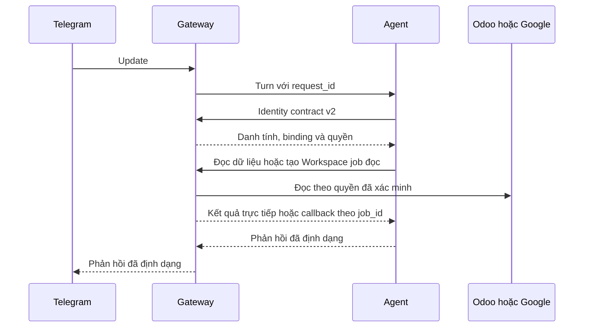
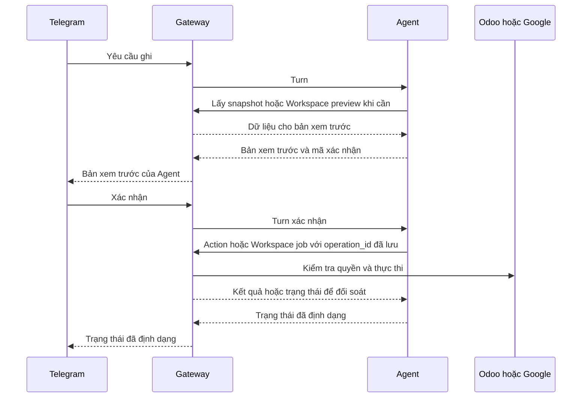

# External Auth Gateway

Dịch vụ FastAPI quản lý đăng nhập Odoo, liên kết Telegram/Google và cung cấp API nội bộ cho các ứng dụng sử dụng danh tính đã xác minh. Gateway giữ credential người dùng, gọi Odoo/Google và nhận/gửi tin Telegram.

README này hướng dẫn cài đặt, cấu hình và vận hành riêng dự án gateway. Tất cả lệnh chạy từ thư mục chứa `pyproject.toml`; không cần mã nguồn của ứng dụng khác.

> **Trạng thái:** bản phát triển có kiểm thử tự động; chưa nghiệm thu toàn bộ với tài khoản thật. Các thao tác ghi còn giới hạn được nêu cuối README.

## Lệnh phát triển

Chạy từ thư mục Gateway sau khi cài `.venv` theo phần [Cài đặt local](#cài-đặt-local).

| Lệnh PowerShell | Tác dụng |
|---|---|
| `./scripts/dev.ps1 doctor` | Kiểm tra Python, pytest, Docker daemon và cấu hình Compose. |
| `./scripts/dev.ps1 up` | Build và khởi động service `gateway`, đợi healthcheck ở cổng `8080`. |
| `./scripts/dev.ps1 test unit` | Chạy test ngoài `tests/integration` và `tests/contract`. |
| `./scripts/dev.ps1 test integration` | Chạy kiểm thử tích hợp độc lập của Gateway. |
| `./scripts/dev.ps1 test contract` | Chạy `tests/contract` để kiểm tra giao diện giữa các thành phần. |
| `./scripts/dev.ps1 test all` | Chạy các nhóm trên. Đây là mặc định của `test`. |
| `./scripts/dev.ps1 down` | Dừng service `gateway` và giữ volume SQLite cùng mạng dùng chung `auth_gateway_net`. |

`test` dùng bản sao mã nguồn tạm, Python trong `.venv` và môi trường con riêng để tách cấu hình và database chạy thật. Script trả về mã thoát của pytest. Hai file `test_full_lifecycle_cross_app.py` và `test_live_cross_app_e2e.py` cần repo Agent bên cạnh nên chạy riêng theo phần kiểm thử tích hợp bên dưới. Các fixture PostgreSQL cần URL kiểm thử riêng và tự bỏ qua khi URL chưa được thiết lập.

[tests/contract/workspace-v1.json](tests/contract/workspace-v1.json) là fixture chuẩn của hợp đồng Workspace v1. Khi cập nhật phiên bản hợp đồng, sao chép nguyên tệp tương ứng sang `tests/contract` của Agent. Bài kiểm thử ghép cặp dùng [test_workspace_peer.py](tests/contract/test_workspace_peer.py) ở Gateway và `tests/contract/workspace_peer.py` ở Agent. Cách chạy với PostgreSQL dùng riêng cho kiểm thử nằm trong [hướng dẫn contract](tests/contract/README.md).

Khởi động Gateway trước Agent khi chạy cả hai bằng Compose. Đặt `AI_AGENT_BASE_URL=http://ai-agent:8000` trong `.env` của Gateway và `GATEWAY_BASE_URL=http://gateway:8000` trong `.env` của Agent. Thiết lập cặp secret theo phần [Cấu hình](#cấu-hình). `up` dùng SQLite trong `compose.yaml`. Phần [Docker](#docker) hướng dẫn vận hành tunnel riêng.

## Điểm vào mã nguồn

| Công việc | Tệp |
|---|---|
| Khởi tạo ứng dụng và healthcheck | [app/main.py](app/main.py) |
| Nhận webhook, xếp hàng và chuyển turn Telegram | [app/telegram/routes.py](app/telegram/routes.py), [app/telegram/worker.py](app/telegram/worker.py) |
| Đổi hợp đồng identity, phân quyền và đọc dữ liệu | [app/internal/identity.py](app/internal/identity.py), [app/internal/google.py](app/internal/google.py), [app/internal/odoo.py](app/internal/odoo.py) |
| Đổi thực thi hoặc tra cứu trạng thái action | [app/internal/actions.py](app/internal/actions.py) |
| Thêm operation Workspace | [app/workspace/catalog.json](app/workspace/catalog.json) khai báo method, scope và schema. [app/workspace/service.py](app/workspace/service.py) kiểm tra quyền và điều phối provider. |
| Đổi luồng job Workspace hoặc chọn tài khoản Google | [app/workspace/routes.py](app/workspace/routes.py), [app/workspace/selection_manager.py](app/workspace/selection_manager.py), [app/workspace/worker.py](app/workspace/worker.py) |
| Sửa truy xuất Drive, xếp hạng hoặc quyền xem tài liệu | [app/workspace/drive_retriever.py](app/workspace/drive_retriever.py), [app/workspace/drive_permissions.py](app/workspace/drive_permissions.py), [app/workspace/drive_runtime.py](app/workspace/drive_runtime.py) |
| Sửa xác nhận draft | Xem bảng điểm vào mã nguồn của Agent. Gateway kiểm tra quyền, tài khoản và operation ID tại API action hoặc lớp Workspace. |

### Đọc dữ liệu



### Ghi dữ liệu



### Đối chiếu log với Agent

1. Từ `update_id` của Telegram, tìm `request_id=tg-<update_id>` trong log `TIMING_AI` ở Gateway và log xử lý turn ở Agent.
2. Với Workspace hoặc Drive, lọc `TELEMETRY` theo `req_id`. Các trường `job_id` và `op_id` trong cùng bản ghi nối log worker với callback Agent và thao tác ghi.
3. Turn tạo preview và turn xác nhận có `request_id` riêng. Dùng `operation_id` đã lưu trong bản xác nhận để đối chiếu action, trạng thái và lần đối soát. Khi chia sẻ log, dùng các mã tương quan và mã trạng thái.

```powershell
docker compose logs --since 10m gateway | Select-String -SimpleMatch 'tg-12345'
# Chạy ở repo Agent
docker compose logs --since 10m ai-agent | Select-String -SimpleMatch 'tg-12345'
```

## Chức năng và trách nhiệm

- Đăng nhập bằng tài khoản và mật khẩu Odoo.
- Ghép nối Telegram qua liên kết một lần từ portal.
- Google OAuth, lưu token đã mã hóa và làm mới token.
- Identity contract v2: user ID, tenant, database, Odoo UID, chức vụ, phòng ban, quản lý, quyền và Telegram binding.
- API đọc Calendar, Gmail chưa đọc, CRM; API action tạo/sửa lịch, gửi thư, tạo/sửa lead.
- Hàng đợi Telegram, chuyển tiếp sang agent và sổ thực thi action theo operation ID.
- Worker xử lý tin nhắn đa chat đồng thời (`ThreadPoolExecutor` 4 luồng song song, khóa FIFO theo `chat_id`).
- Cache xác thực danh tính/quyền Odoo 60s trong bộ nhớ (actions API luôn bypass cache).
- Phản hồi tương tác tức thì: gửi `sendChatAction: typing` ngay khi nhận tin từ Telegram.
- Các module đồng bộ lịch Odoo–Google và nhắc hẹn có sẵn; cần kiểm chứng riêng trước khi bật trên lịch thật.

### Tối ưu Thông lượng và Độ trễ Phản hồi (Gateway Performance)

| Chỉ số | Trước tối ưu | Sau tối ưu | Lợi ích |
|---|---|---|---|
| **Xử lý tin nhắn Telegram** | Đơn luồng tuần tự (`max_workers=1`) | **Đa luồng song song (`max_workers=4`)** | Nhiều người dùng nhắn cùng lúc không bị block hàng đợi; vẫn bảo đảm FIFO tuyệt đối trên mỗi chat riêng |
| **Xác minh danh tính Odoo** | Gọi XML-RPC mỗi turn (1.5s – 2.5s) | **Cache bộ nhớ an toàn 60s** | Giảm 90% tải lên Odoo server; giảm độ trễ mỗi turn đọc xuống còn < 50ms |
| **Tín hiệu trực quan** | Im lặng khi Agent đang suy nghĩ | **Gửi `typing` tức thì (< 300ms)** | Người dùng nhận phản hồi thị giác ngay lập tức, không cảm thấy bot bị treo |
| **Bảo vệ thao tác ghi** | - | **Bypass cache 100% đối với actions** | Thao tác ghi dữ liệu luôn kiểm tra quyền Odoo trực tiếp thời gian thực |

Chuyển tiếp AI là tích hợp tùy chọn qua HTTP. Ứng dụng nhận yêu cầu cần tuân thủ contract API và tự quản lý luồng hội thoại, bản xem trước, xác nhận.

## Yêu cầu

- Python 3.11 trở lên; ví dụ dưới dùng Python 3.11 trên Windows PowerShell.
- Tenant Odoo cho phép truy cập API và tài khoản nhân viên có quyền phù hợp.
- Google OAuth client, các API Google cần dùng và Telegram bot token.
- Nếu bật chuyển tiếp AI, cần URL của dịch vụ nhận yêu cầu và hai secret giao tiếp được thống nhất.

Gateway chạy local với SQLite. Cấu hình PostgreSQL dùng cho luồng Workspace với worker riêng, hàng đợi bền vững và chỉ mục Drive có pgvector. Cloudflare Tunnel là tùy chọn.

## Cài đặt local

Chạy từ thư mục chứa `pyproject.toml`:

```powershell
py -3.11 -m venv .venv
.\.venv\Scripts\python.exe -m pip install -e ".[dev]"
# Bỏ qua nếu đã có .env, tránh ghi đè cấu hình hiện tại.
Copy-Item .env.example .env
```

Sinh khóa Fernet và hai secret dịch vụ, rồi lưu vào `.env`:

```powershell
.\.venv\Scripts\python.exe -c "from cryptography.fernet import Fernet; print(Fernet.generate_key().decode())"
.\.venv\Scripts\python.exe -c "import secrets; print(secrets.token_urlsafe(48)); print(secrets.token_urlsafe(48))"
```

Thay mọi giá trị minh họa trong `.env.example`. Không thay khóa mã hóa của database đang có.

## Cấu hình

| Biến | Cách sử dụng |
|---|---|
| `APP_ENV` | `development` cho local; `production` yêu cầu URL HTTPS và khóa Fernet hợp lệ |
| `PUBLIC_BASE_URL` | URL portal, local thường là `http://localhost:8080` |
| `ODOO_URL`, `ODOO_DB` | URL tenant và tên database Odoo |
| `DATABASE_URL` | Ví dụ `sqlite:///./data/gateway.db`, tính từ thư mục chạy |
| `ENCRYPTION_KEY` | Khóa Fernet mã hóa credential và OAuth token |
| `GOOGLE_CLIENT_ID`, `GOOGLE_CLIENT_SECRET` | OAuth client của gateway |
| `GOOGLE_WORKSPACE_DOMAINS` | Để trống cho mọi tài khoản Google, gồm Gmail cá nhân; điền miền để giới hạn |
| `TELEGRAM_BOT_TOKEN`, `TELEGRAM_BOT_USERNAME` | Bot nhận/gửi tin và tạo liên kết ghép nối |
| `TELEGRAM_WEBHOOK_SECRET` | Secret kiểm tra webhook Telegram |
| `ENABLE_AI_AGENT_FORWARDING` | `true` để chuyển hội thoại sang agent; `false` để chạy gateway độc lập |
| `AI_AGENT_BASE_URL` | URL agent truy cập được từ gateway, local thường là `http://localhost:8000` |
| `GATEWAY_TO_AGENT_SECRET` | Secret chiều gateway gọi agent |
| `AGENT_TO_GATEWAY_SECRET` | Secret chiều agent gọi gateway |

Để chạy gateway độc lập, đặt `ENABLE_AI_AGENT_FORWARDING=false`. Portal, OAuth và các lệnh Telegram xử lý tại gateway vẫn có thể sử dụng mà không cần dịch vụ AI.

Nếu bật forwarding, hai secret phải khác nhau, mỗi secret ít nhất 32 ký tự và khớp với bên gọi/nhận API. Code mặc định forwarding là `false`; file mẫu có bật sẵn nên cần kiểm tra trước khi chạy.

### Google OAuth

Đăng ký redirect URI đúng bằng `<PUBLIC_BASE_URL>/oauth/google/callback`, ví dụ:

```text
http://localhost:8080/oauth/google/callback
```

Cấu hình OAuth consent và test users phù hợp với môi trường Google. Mã hiện yêu cầu OpenID/email, Calendar và Gmail đọc/gửi. Tài khoản đã liên kết trước đây có thể cần cấp quyền lại.

Khi không giới hạn miền, email Google không bắt buộc khớp email Odoo. Việc liên kết Google không cấp thêm quyền CRM hoặc chức vụ Odoo.

## Khởi động và sử dụng

```powershell
.\.venv\Scripts\python.exe -m uvicorn app.main:app --host 127.0.0.1 --port 8080
```

- Portal: [http://localhost:8080/](http://localhost:8080/).
- Healthcheck: [http://localhost:8080/healthz](http://localhost:8080/healthz).

Quy trình nhân viên: đăng nhập Odoo trên portal → liên kết Telegram và bấm Start trong bot → liên kết Google. Có thể dùng `/status`, `/help`, `/crm` và `/crm <từ khóa>` trên bot. Yêu cầu AI chỉ được chuyển tiếp khi cấu hình forwarding đã bật.

Để nhận Telegram khi phát triển local, mở terminal thứ hai trong cùng thư mục:

```powershell
.\.venv\Scripts\python.exe scripts/telegram_poller.py
```

Chọn poller hoặc webhook cho cùng bot; poller cần bot không có webhook đang hoạt động. Chỉ vận hành một nguồn thu update cho bot. API và poller phải dùng cùng database/cấu hình.

## API tích hợp

API nội bộ dùng `Authorization: Bearer <AGENT_TO_GATEWAY_SECRET>`.

| Endpoint | Chức năng |
|---|---|
| `POST /internal/v1/identity/resolve` | Xác minh Telegram user/private chat; agent yêu cầu contract v2 |
| `GET /internal/v1/users/{id}/connections` | Trạng thái dịch vụ và Google scopes |
| `GET /internal/v1/users/{id}/calendar/events` | Lịch theo `time_min`, `time_max` |
| `GET /internal/v1/users/{id}/gmail/unread` | Gmail chưa đọc |
| `GET /internal/v1/users/{id}/crm/leads` | Tra cứu lead cá nhân |
| `GET /internal/v1/users/{id}/calendar/events/{event_id}` | Chi tiết sự kiện lịch (kèm ETag để bảo đảm cập nhật một phần qua PATCH) |
| `GET /internal/v1/users/{id}/crm/leads/{lead_id}` | Chi tiết cơ hội CRM (kèm `expected_write_date` chống ghi đè xung đột) |
| `POST /internal/v1/users/{id}/actions` | Action giới hạn theo quyền, binding và operation ID |
| `GET /internal/v1/users/{id}/actions/{operation_id}` | Tra cứu trạng thái và đối soát thao tác theo operation ID; xác minh tài khoản Odoo và quyền truy cập |

Action có trong mã: `calendar.create`, `calendar.update`, `gmail.send`, `crm.create`, `crm.update`. Agent gọi sau khi người dùng xác nhận. API không cung cấp quyền gọi tùy ý model/method Odoo.

## Docker

`compose.yaml` gồm gateway và Cloudflare Tunnel, ánh xạ gateway `8080:8000`, lưu SQLite trong volume `auth_gateway_data`.

```powershell
# Chỉ chạy gateway nếu chưa dùng Cloudflare Tunnel.
docker compose up -d --build gateway
docker compose logs -f gateway
```

Cấu hình `CLOUDFLARE_TUNNEL_TOKEN` trước khi chạy thêm service `tunnel`.

Khi chạy Workspace với PostgreSQL, dùng [compose.postgres.yaml](compose.postgres.yaml) cùng `compose.yaml`. Cấu hình này có migration, worker Workspace và Drive indexer riêng. Phần kiểm thử ghép cặp bên trên dùng PostgreSQL dành riêng cho test.

Nếu chuyển tiếp tới dịch vụ AI chạy trong container khác, đặt `AI_AGENT_BASE_URL` theo địa chỉ truy cập được từ container gateway. Có thể dùng mạng `auth_gateway_net` và tên service/alias của dịch vụ đích. `localhost` trong container chỉ trỏ về chính container; cổng nội bộ gateway là `8000`.

## Kiểm thử và kiểm tra mã nguồn (Linting)

```powershell
# Kiểm tra chuẩn mã nguồn.
.\.venv\Scripts\python.exe -m ruff check app tests

# Chạy các nhóm kiểm thử độc lập của Gateway.
./scripts/dev.ps1 test all

# Chạy nhóm tích hợp xuyên dịch vụ khi có repo Agent và cấu hình kiểm thử riêng.
.\.venv\Scripts\python.exe -m pytest tests/integration/test_full_lifecycle_cross_app.py tests/integration/test_live_cross_app_e2e.py -v
```

Kết quả trước và sau đợt tái cấu trúc, gồm các ca kiểm thử còn lỗi và phạm vi lint, nằm trong [báo cáo xác minh](docs/refactor-verification.md).

Các nhóm kiểm thử độc lập dùng SQLite tạm và mô phỏng XML-RPC, Google và Telegram. Bộ hồi quy CRM kiểm tra cấu trúc domain `[("id", "=", record_id)]` trong lời gọi `search_read`, xung đột `write_date` và việc chặn ghi khi bị từ chối. Checklist bên dưới dành cho nghiệm thu trên tài khoản thật.

## Checklist tự nghiệm thu bằng tài khoản thật (Dành cho người dùng)

Người dùng thực hiện lần lượt 5 bước kiểm thử thực tế sau khi cấu hình đầy đủ thông tin vào `.env`:

1. **Đăng nhập Odoo và liên kết Telegram/Google:**
   - Truy cập portal [http://localhost:8080](http://localhost:8080) và đăng nhập bằng tài khoản và mật khẩu Odoo của tenant đã cấu hình.
   - Nhấn nút liên kết Telegram, mở bot và bấm `/start` để hoàn tất ghép nối.
   - Nhấn nút liên kết Google, đăng nhập tài khoản Google (hỗ trợ cả Gmail cá nhân nếu để trống `GOOGLE_WORKSPACE_DOMAINS`) và cấp đủ quyền Calendar/Gmail.
2. **Kiểm tra hồ sơ, quyền, lịch, Gmail và CRM:**
   - Trên Telegram bot, gửi các lệnh: `Tôi là ai?`, `Kiểm tra kết nối`, `/calendar list`, `/email list`, `/crm search <từ khóa>`.
   - Đối chiếu kết quả trả về với thông tin nhân viên trong Odoo và dữ liệu thực tế trên Google Workspace.
3. **Tạo và sửa dữ liệu thử nghiệm (Task, Calendar, CRM):**
   - Gửi lệnh tạo/sửa lịch: `/calendar create [TEST] Họp dự án | 2026-11-05T09:00:00+07:00 | 2026-11-05T10:00:00+07:00`.
   - Gửi lệnh tạo lead CRM: `/crm create [TEST] Khách hàng tiềm năng | 0900000000 | test@example.com | 5000000`.
   - Kiểm tra bot phản hồi tin nhắn bản xem trước (preview) kèm mã xác nhận.
   - Gửi `/confirm <mã>` -> kiểm tra thông báo hoàn thành và kiểm tra bản ghi tương ứng đã xuất hiện trên Google Calendar và CRM Odoo thật.
4. **Gửi một email thử nghiệm:**
   - Gửi lệnh: `/email send <email-cá-nhân-của-bạn> | [TEST] Email thử nghiệm | Xin chào, đây là email kiểm tra tích hợp.`
   - Kiểm tra bản xem trước, gửi `/confirm <mã>` và kiểm tra email thực tế đã đến hộp thư người nhận.
5. **Kiểm tra thiếu quyền, hủy xác nhận, confirm lại và ngắt/ghép nối lại Telegram:**
   - Tạo một thao tác mới, nhận mã preview rồi gửi `/cancel <mã>` -> kiểm tra thao tác bị hủy và không có bản ghi nào bị ghi ra ngoài.
   - Thử gửi lại `/confirm <mã>` cho mã đã hủy hoặc đã thực thi -> kiểm tra hệ thống từ chối hoặc trả kết quả đã lưu, không thực thi trùng lặp.
   - Trên portal, thử hủy liên kết Telegram và gửi lệnh trên bot -> kiểm tra bot từ chối yêu cầu do chưa ghép nối danh tính. Sau đó ghép nối lại bằng token mới và xác nhận bot hoạt động bình thường trở lại.

## Giới hạn hiện tại và lưu ý vận hành

- API action trả về trạng thái `UNKNOWN_RESULT` khi gặp sự cố mạng hoặc timeout. Agent giữ nguyên `operation_id` đã lưu từ preview để đối soát, không tự động sinh lại ID mới hay thực thi lặp lại.
- Cập nhật Google Calendar sử dụng HTTP `PATCH` kèm header `If-Match: etag` để tránh mất các trường không sửa; cập nhật CRM sử dụng `expected_write_date` để phát hiện xung đột dữ liệu.
- `.env.example` cung cấp các tham số mẫu. Cần kiểm tra forwarding, secrets (tối thiểu 32 ký tự và phân biệt hai chiều), địa chỉ service và cấu hình miền Google trong môi trường triển khai thực tế.
- Healthcheck phản hồi thành công xác nhận server hoạt động, không thay thế việc kiểm tra hiệu lực liên kết OAuth hoặc tài khoản Odoo của từng cá nhân.

## Dữ liệu và tài liệu

Không commit `.env`, token, database hoặc bản sao lưu. Giữ database cùng khóa mã hóa tương ứng; không xóa volume để xử lý một lỗi kết nối.

- [Cấu hình dịch vụ](docs/SETUP.md).
- [Tích hợp AI Agent](docs/INTEGRATION_AI_AGENT.md).
- [Vận hành và sao lưu](docs/OPERATIONS.md).
- [Checklist nghiệm thu](docs/ACCEPTANCE.md).

Một số tài liệu chi tiết phản ánh giai đoạn trước; đối chiếu README và mã hiện tại khi có khác biệt.
