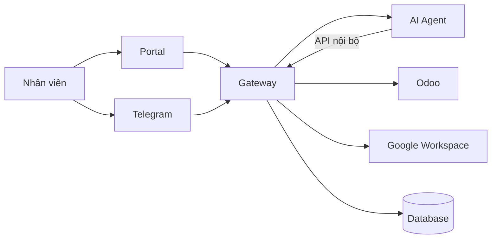

# Auth Gateway

Auth Gateway là dịch vụ FastAPI kết nối tài khoản Odoo của nhân viên với Telegram và Google Workspace. Người dùng đăng nhập Portal, liên kết tài khoản rồi gửi yêu cầu qua Telegram.

Gateway giữ thông tin xác thực, kiểm tra quyền, gọi Odoo/Google và giao phản hồi Telegram. AI Agent là ứng dụng riêng, phụ trách hiểu câu chat, quản lý hội thoại và chuẩn bị xác nhận.

## Đọc tài liệu theo nhu cầu

| Nhu cầu | Tài liệu |
|---|---|
| Cài đặt và chạy lần đầu | [SETUP.md](docs/SETUP.md) |
| Hiểu luồng giao tiếp với Agent | [INTEGRATION_AI_AGENT.md](docs/INTEGRATION_AI_AGENT.md) |
| Xem log, sao lưu, xử lý lỗi | [OPERATIONS.md](docs/OPERATIONS.md) |
| Kiểm tra trước khi bàn giao | [ACCEPTANCE.md](docs/ACCEPTANCE.md) |
| Sửa giao diện Portal | [DESIGN.md](DESIGN.md) |
| Kiểm tra hợp đồng Workspace | [Contract README](tests/contract/README.md) |

## Cấu trúc mã nguồn

| Đường dẫn | Vai trò |
|---|---|
| [app/main.py](app/main.py) | Tạo FastAPI app, gắn router, khởi động worker theo cấu hình |
| [app/config.py](app/config.py) | Biến môi trường và kiểm tra cấu hình |
| [app/db.py](app/db.py), [app/models.py](app/models.py) | Kết nối database và các bảng dùng chung |
| [app/security.py](app/security.py) | Mã hóa và tiện ích bảo mật |
| app/auth/ | Đăng nhập Odoo và quản lý phiên Portal |
| app/portal/ | Route, template và tài nguyên giao diện |
| app/odoo/ | Client và service gọi Odoo |
| app/google/ | OAuth, token và client Google |
| app/telegram/ | Liên kết bot, nhận update, xử lý hàng đợi, gửi phản hồi |
| app/internal/ | API cho Agent, gồm danh tính, quyền, đọc dữ liệu và action |
| app/business/ | Catalog nghiệp vụ Odoo, tra cứu, chuẩn bị và thực thi |
| app/quotations/ | Báo giá bán, PDF và luồng duyệt |
| app/reporting/ | Tạo báo cáo và worker báo cáo |
| app/workspace/ | Công cụ Google Workspace, chọn tài khoản, job và truy xuất Drive |
| app/calendar/ | Đồng bộ lịch và nhắc hẹn |
| app/jobs/ | Tác vụ định kỳ |
| alembic/ | Migration database |
| scripts/ | Công cụ phát triển, kiểm tra Odoo và sao lưu |
| tests/ | Kiểm thử đơn vị, tích hợp và hợp đồng |
| docs/ | Tài liệu cấu hình, tích hợp, vận hành, nghiệm thu |

## Luồng xử lý



Với yêu cầu đọc, Agent gọi Gateway lấy dữ liệu trong phạm vi tài khoản đã xác minh rồi định dạng phản hồi. Với yêu cầu ghi, người dùng xem và xác nhận trước khi Gateway thực thi. Mỗi thao tác ghi có mã operation_id để theo dõi và đối soát.

## Chạy local

Chạy trong thư mục chứa pyproject.toml bằng PowerShell với Python 3.11.

```powershell
py -3.11 -m venv .venv
.\.venv\Scripts\python.exe -m pip install -e ".[dev]"
if (-not (Test-Path .env)) { Copy-Item .env.example .env }
```

Điền cấu hình theo [SETUP.md](docs/SETUP.md), rồi chạy dịch vụ.

```powershell
.\.venv\Scripts\python.exe -m uvicorn app.main:app --host 127.0.0.1 --port 8080
```

Portal ở http://localhost:8080. Healthcheck ở http://localhost:8080/healthz.

## Lệnh phát triển

| Lệnh | Tác dụng |
|---|---|
| `./scripts/dev.ps1 doctor` | Kiểm tra môi trường và Docker |
| `./scripts/dev.ps1 up` | Build và chạy Gateway bằng Compose |
| `./scripts/dev.ps1 down` | Dừng Gateway, giữ dữ liệu volume |
| `./scripts/dev.ps1 test unit` | Kiểm thử đơn vị |
| `./scripts/dev.ps1 test integration` | Kiểm thử tích hợp độc lập |
| `./scripts/dev.ps1 test contract` | Kiểm thử hợp đồng |
| `./scripts/dev.ps1 test all` | Các nhóm test do script quản lý |

Các bài thử xuyên hai repo và PostgreSQL có điều kiện chạy riêng trong [ACCEPTANCE.md](docs/ACCEPTANCE.md).

## Bắt đầu sửa code ở đâu

Bắt đầu từ router của phân hệ, theo sang service rồi client. Ví dụ mua hàng đi qua [business/routes.py](app/business/routes.py), [catalog.py](app/business/catalog.py), [service.py](app/business/service.py) và [VerifiedContext](app/reporting/context.py).

Action có trong catalog vẫn cần cờ cấu hình, quyền tài khoản và trạng thái chứng từ phù hợp. Khi bàn giao, ghi rõ môi trường và bằng chứng kiểm tra theo tài liệu nghiệm thu.
