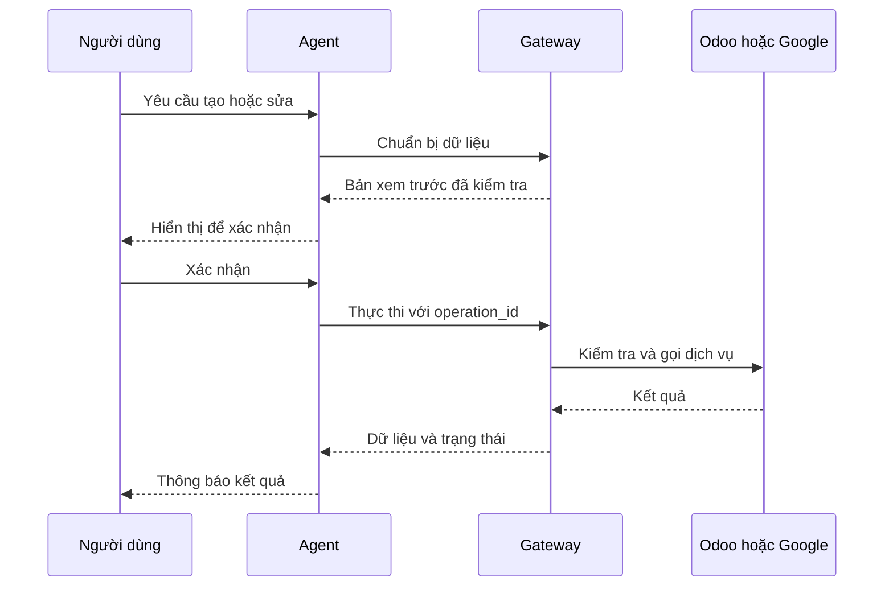

# Tích hợp Gateway với AI Agent

Tài liệu giải thích cách một yêu cầu đi qua hai ứng dụng và vị trí cần đọc khi thay đổi luồng.

## Trách nhiệm

| Gateway | Agent |
|---|---|
| Xác thực Odoo, giữ credential và token đã mã hóa | Hiểu yêu cầu và chọn công cụ |
| Quản lý liên kết Telegram và tài khoản Google | Quản lý hội thoại và nháp |
| Nhận update, gọi dịch vụ, lưu trạng thái thực thi | Chuẩn bị bản xem trước và nhận xác nhận |
| Kiểm tra quyền và giao kết quả Telegram | Định dạng phản hồi |

## Địa chỉ và xác thực

| Cấu hình | Local | Hai container cùng mạng |
|---|---|---|
| AI_AGENT_BASE_URL ở Gateway | http://localhost:8000 | http://ai-agent:8000 |
| GATEWAY_BASE_URL ở Agent | http://localhost:8080 | http://gateway:8000 |

Agent dùng INTEGRATION_MODE=gateway. Gateway dùng ENABLE_AI_AGENT_FORWARDING=true.

GATEWAY_TO_AGENT_SECRET bảo vệ chiều Gateway gọi Agent. AGENT_TO_GATEWAY_SECRET bảo vệ chiều Agent gọi Gateway. API nội bộ Gateway nhận header Authorization với Bearer token bằng secret chiều Agent gọi Gateway.

## Một lượt đọc dữ liệu

1. app/telegram/routes.py nhận update và lưu vào hàng đợi.
2. app/telegram/worker.py gọi POST /internal/v1/telegram/turn của Agent.
3. Agent gọi POST /internal/v1/identity/resolve để xác minh danh tính và liên kết.
4. Agent gọi API đọc hoặc tạo job đọc ở Gateway.
5. Gateway kiểm tra phạm vi tài khoản rồi gọi Odoo hoặc Google.
6. Agent định dạng kết quả, Gateway giao nội dung đến Telegram.

Workspace có thể xử lý nền và trả kết quả bằng callback. Xem app/workspace/routes.py và app/workspace/worker.py.

## Một lượt ghi dữ liệu

Sơ đồ rút gọn phần truyền tin qua Telegram. operation_id nhận diện một lần thực thi. prepared_id nhận diện bản chuẩn bị Business. Agent gắn mã xác nhận với bản xem trước và gửi prepared_id tương ứng khi người dùng đồng ý.

Khi kết quả là UNKNOWN_RESULT, đối soát bằng operation_id đã lưu và kiểm tra dịch vụ đích trước khi quyết định bước tiếp theo.

## Tìm API trong code

Các endpoint dưới đây có tiền tố /internal/v1. {id} là ID người dùng Gateway.

| Nhóm | Đường dẫn tiêu biểu | File |
|---|---|---|
| Danh tính | POST /identity/resolve | app/internal/identity.py |
| Calendar, Gmail, CRM | /users/{id}/calendar, /gmail, /crm | app/internal/google.py, app/internal/odoo.py |
| Action và trạng thái | /users/{id}/actions | app/internal/actions.py |
| Nghiệp vụ Odoo | /users/{id}/business/lookup, /prepare, /capabilities | app/business/routes.py |
| Báo giá | /users/{id}/quotations/prepare và các route PDF, duyệt | app/quotations/routes.py |
| Báo cáo | /users/{id}/reports | app/reporting/routes.py |
| Workspace | /users/{id}/workspace/query, /preview, /jobs | app/workspace/routes.py |

Đọc router cùng schema của từng phân hệ để lấy phương thức HTTP và payload chính xác.

## Phạm vi tài khoản

User ID Gateway, tenant, database và Odoo UID xác định tài khoản nghiệp vụ. Telegram user, chat và binding xác định liên kết đang dùng.

[VerifiedContext](../app/reporting/context.py) xác minh tài khoản và giới hạn công ty trong lời gọi Odoo. Workspace kiểm tra tài khoản Google được chọn qua lớp selection manager. Khi liên kết thay đổi, yêu cầu cũ phải được kiểm tra lại.

## Luồng mua hàng trong code hiện tại

1. Tra cứu nhà cung cấp và sản phẩm thật qua Business lookup.
2. Gửi business.purchases.create đến Business prepare.
3. Gateway kiểm tra dữ liệu và lấy các giá trị dòng RFQ còn thiếu từ form Odoo.
4. Gateway lưu bản chuẩn bị, Agent hiển thị để xác nhận.
5. Gọi Actions với prepared_id và operation_id để tạo RFQ.
6. Dùng business.purchases.confirm với bản xem trước riêng để xác nhận RFQ.
7. Nếu Odoo trả to approve, đơn đang chờ duyệt. business.purchases.approve xử lý bước duyệt khi quyền và chứng từ cho phép.

Code kiểm tra nút và điều kiện duyệt nằm trong app/business/service.py. Luồng duyệt tùy chỉnh chưa được hỗ trợ có thể chặn bước xác nhận. Cần đối chiếu kết quả đọc lại từ Odoo khi nghiệm thu.

## Các mã theo dõi

| Mã | Ý nghĩa |
|---|---|
| update_id | Update Telegram đầu vào |
| request_id | Một lượt xử lý, thường có dạng tg-<update_id> |
| job_id | Job nền |
| operation_id | Thao tác ghi và các lần đối soát |
| prepared_id | Bản chuẩn bị Business |

Dùng request_id tìm lượt xử lý ở Gateway và Agent, sau đó theo job_id hoặc operation_id để xem bước thực thi. Xem [OPERATIONS.md](OPERATIONS.md) khi xử lý lỗi.
